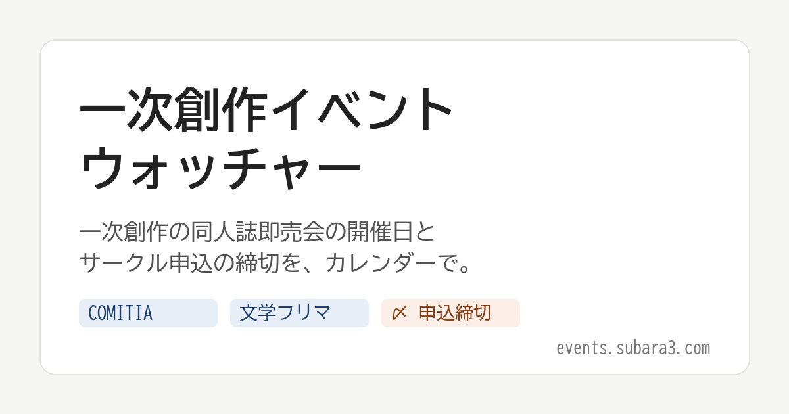

# 一次創作イベントウォッチャー

一次創作（オリジナル作品）の同人誌即売会の開催日と、サークル申込の締切をまとめたサイトのソースです。

- サイト: https://events.subara3.com/
- 記事: 【microCMS】同人イベントの日程まとめを、MCPとAgent Skillsで（ほぼ）自動化した



## 構成

```
microCMS（Hobbyプラン）
  ├ events（イベント）
  └ editions（開催回）── events を参照
        │ ビルド時に microcms-js-sdk で取得
Next.js 16（App Router、output: 'export'）
        │ GitHub Actions で静的ファイルを作り、FTPで同期
レンタルサーバー（Node.jsなし）
        └ お問い合わせ → PHP（public/tip.php）→ Discord Webhook
```

microCMSのAPIの設計と作成、開催回の登録は、Claude Codeから公式のAgent Skills（microcms-guide / microcms-nextjs）と公式リモートMCPを使って行いました。

## できること

- リストとカレンダーの切り替え。都道府県・種類・「申込受付中だけ」で絞り込み
- 申込の状態（受付前・受付中・締切）と「あと何日」は、見ている人のブラウザで日付から計算する
- 期間のある開催は、カレンダーで週をまたいだ帯で表示する
- `calendar.ics`：開催日とサークル申込の締切を、カレンダーアプリに取り込める
- フッターの「お問い合わせ」から送った内容が、Discordに届く

## microCMSのAPI

### events（リスト形式）

| fieldId | 種類 | 必須 |
|---|---|---|
| name | テキスト（重複不可） | ○ |
| kind | セレクト（COMITIA系 / 文学フリマ / ZINE / 創作全般 / その他） | ○ |
| officialUrl | テキスト | ○ |
| organizer | テキスト | |
| note | テキストエリア | |

### editions（リスト形式）

| fieldId | 種類 | 必須 |
|---|---|---|
| event | コンテンツ参照（events） | ○ |
| label | テキスト（回） | ○ |
| startDate / endDate | 日時（日付のみ） | 開始のみ○ |
| hours | テキスト | |
| prefecture | セレクト（47都道府県＋オンライン） | ○ |
| venue | テキスト | ○ |
| pageUrl | テキスト（その回の公式ページ） | ○ |
| entryStart / entryEnd | 日時（日付のみ） | |
| entryNote / circleFee / admissionFee | テキスト | |
| schedule | セレクト（予定どおり / 延期 / 中止 / 未定） | ○ |
| verifiedAt / verifiedBy / source | 照合の記録（サイトには出さない） | |

日付は「日付のみ」にしています。APIはUTCで返すので、表示するときに日本時間に直します（`src/lib/dates.ts`）。

## 手元で動かす

```bash
npm ci
cp .env.example .env.local   # MICROCMS_SERVICE_DOMAIN と MICROCMS_API_KEY を書く
npm run build                # out/ に静的ファイルができる
```

- APIキーはビルドのときだけ使い、ブラウザには渡しません。`out/` にキーが含まれないことを、ワークフローでも確かめています。
- `npm run build` は、前回ビルドのキャッシュ（`.next`）を消してからビルドします。消さないと、microCMSで足した開催が反映されないことがありました。

## GitHub Actions

| ワークフロー | きっかけ | 中身 |
|---|---|---|
| `deploy.yml` | microCMSのWebhook（`repository_dispatch: microcms-update`）、毎朝6時、手動 | ビルドして、`lftp` でサーバーのフォルダと同期 |
| `watch-official.yml` | 毎朝9時、手動 | 開催回の公式ページを取得して前日と比べ、変わっていたらDiscordに知らせる |

使うSecrets: `MICROCMS_SERVICE_DOMAIN` `MICROCMS_API_KEY` `FTP_USER` `FTP_PASSWORD` `DISCORD_WEBHOOK_URL`

公式ページの見張りは知らせるところまでで、データを直すのは人です。公式サイトによっては、GitHub Actionsのサーバーからのアクセスを403で断ります。その場合は、取れなくなったときに1回だけ知らせます。

## お問い合わせ（public/tip.php）

DiscordのWebhook URLは、サーバーの `_private/config.php` に置きます。Gitには入れず、Webからは読めない設定です。

```php
<?php
return ['discord_webhook' => 'https://discord.com/api/webhooks/...'];
```

ボット避けの見えない欄、同じ接続元から1時間5件まで、メンションの無効化を入れています。

## ライセンス

MIT License（`LICENSE`）。サイトに載せている開催情報は、各イベントの公式発表をもとにしたものです。
